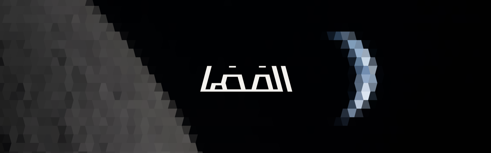

<p align="center">
  
</p>

# المَهَا (al-maha)

An open-source replica of the UAE's **Rashid** lunar rover, built to match the original's dimensions as faithfully as possible.

*Al-maha* (المَهَا) is the Arabian oryx, and also the word for the oryx's eyes in classical Arabic poetry.

> **Status: early.** Branding is done, and a first pass at the original's dimensions is recorded in [`docs/original-dimensions.md`](docs/original-dimensions.md). Gaps remain (stowed envelope, body height and sidewall angle, solar panel size, suspension). There is no CAD or BOM yet. Everything below says what exists and what doesn't.

## Goal
Reproduce Rashid (MBRSC, Dubai) at the original's dimensions. Primary sources (MBRSC conference material and the instrument teams' *Space Science Reviews* papers) give a 10 kg rover, 470 x 505 mm in plan and 700 mm tall with the mast deployed, on four wheels of 200 mm diameter and about 80 mm width. Each dimension in this repo cites its source or is marked unverified, and open conflicts are listed alongside.

This is an independent hobby project, not affiliated with or endorsed by MBRSC.

## What's here
| Path | Contents |
|---|---|
| [`docs/`](docs/original-dimensions.md) | Sourced record of the original rover's dimensions, with a source tag and status on every value |
| [`graphic-design/`](graphic-design/README.md) | Square Kufic wordmark and an Earthset mosaic poster, plus the Python scripts that generate them |
| `hardware/` | *Not yet created.* Planned home for CAD, drawings and the BOM |

## Provisional design notes
Early planning (a 15 degree wedge body around a 6U CubeSat envelope, 200 x 80 mm wheels, rocker suspension with Ackermann steering) came from brainstorming for a rover *inspired by* Rashid, before the project became a faithful replica. It does not bind the replica and is overridden wherever it conflicts with the original. Already known to differ: the CubeSat envelope (the original is 470 x 505 x 700 mm), the solar panel layout, the steering, and the missing mast. The 200 x 80 mm wheel size matches. See section 6 of [`docs/original-dimensions.md`](docs/original-dimensions.md).

## Regenerating the graphics
```
pip install -r requirements.txt
python3 graphic-design/scripts/build_wordmark.py            # wordmark SVG
cd graphic-design/scripts/mosaic && python3 header.py edge-coarse   # README header
```
Details and the other scripts are in [`graphic-design/README.md`](graphic-design/README.md).

## Contributing
Corrections to Rashid's dimensions are the most valuable contribution, ideally with a primary source (MBRSC material, mission documentation, or photographs with known scale). The most useful missing facts are listed in section 7 of [`docs/original-dimensions.md`](docs/original-dimensions.md). Arabic readers' feedback on wordmark legibility is also wanted.

## License model
- **Code** (scripts, firmware, tooling) is licensed under **Apache-2.0** (see [`LICENSE`](LICENSE)).
- **Hardware designs, mechanical documentation and bills of materials** are licensed under **CERN-OHL-S-2.0**, strongly reciprocal (see [`LICENSE-HARDWARE.txt`](LICENSE-HARDWARE.txt)).
- **Graphics and other documentation** (wordmark, poster, headers, READMEs) are licensed under **CC BY 4.0** (see [`LICENSE-DOCUMENTATION.txt`](LICENSE-DOCUMENTATION.txt)).

Unless otherwise noted, files are licensed according to the category they fall under. Third-party material, including the NASA photographs, is not covered by these licences; see [`NOTICE.md`](NOTICE.md).
